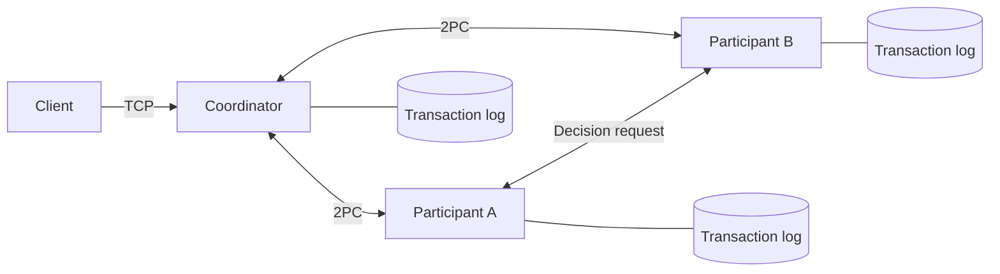
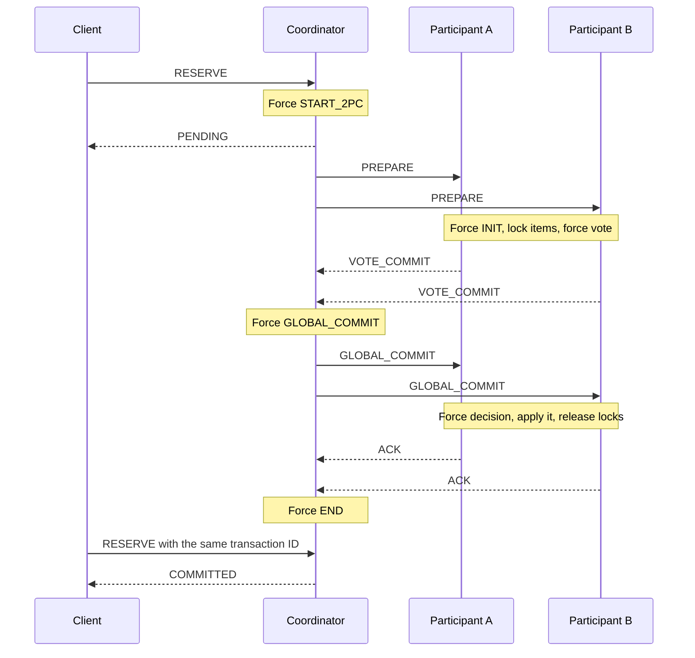

# Distributed Reservation System

A Java 17 reservation system. Servers use Two-Phase Commit (2PC) over TCP
to reserve items in one transaction and recover them after a crash.

Politecnico di Milano · Distributed Systems (090950) · [Project 2](docs/requirements.md) · 2026/2027

## Architecture

One server can act as both coordinator and participant for the same request.
See [server roles and locks](docs/architecture.md).



## Commit flow



See [decision rules](docs/protocol.md#prepare-and-decide) and
[restart behavior](docs/recovery.md#replay).

## Project structure

```text
distributed-reservation/
├── .gitignore
├── README.md
├── config/                            # Cluster profiles
│   ├── cluster.lan.properties.example # Physical machines
│   ├── cluster.local.properties       # Loopback
│   └── cluster.vm.properties          # Two-VM lab
├── docs/                              # Design and run guides
│   ├── architecture.md
│   ├── deployment.md
│   ├── implementation.md
│   ├── protocol.md
│   ├── recovery.md
│   ├── requirements.md
│   ├── testbed.md
│   └── testing.md
├── infra/                             # VM setup and fault experiments
│   ├── cloud-init.yaml
│   ├── collect-logs.sh
│   ├── deploy.sh
│   ├── fault.sh
│   ├── lib.sh
│   ├── network.sh
│   ├── provision.sh
│   ├── reservation@.service
│   └── reset.sh
├── scripts/                           # Local development commands
│   ├── build.sh                       # Build the JAR
│   ├── local.sh                       # Run on loopback
│   └── test.sh                        # Run the test suite
├── src/                               # Java application
│   └── reservation/
│       ├── Client.java
│       ├── ClusterConfig.java
│       ├── Coordinator.java
│       ├── Endpoint.java
│       ├── Faults.java
│       ├── FrameFields.java
│       ├── Main.java
│       ├── Message.java
│       ├── Participant.java
│       ├── ResourceManager.java
│       ├── Server.java
│       ├── TransactionLog.java
│       ├── Transport.java
│       ├── TxId.java
│       ├── Type.java
│       └── Wire.java
└── tests/
    ├── integration/                   # TCP and crash tests
    │   └── test_cluster.py
    └── unit/                          # Codec, log, and locks
        └── UnitTests.java
```

## Run

Run `./scripts/test.sh` with a JDK 17 or newer and Python 3. Use the
[laptop testbed](docs/testbed.md) or the [deployment guide](docs/deployment.md)
to run the application.
