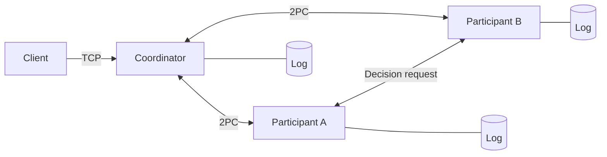
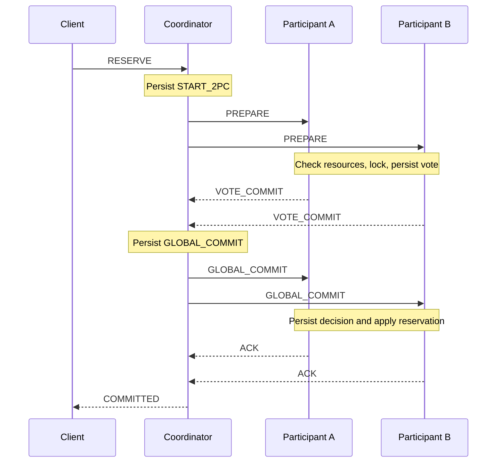

# Distributed Reservation System

A fault-tolerant distributed reservation system based on Two-Phase Commit (2PC). Clients reserve resources across multiple servers in a single atomic transaction.

Politecnico di Milano · Distributed Systems (090950) · Project 2 · 2026/2027

The project is at the planning stage.

## Features

- Atomic reservations across independent servers
- Two-Phase Commit (2PC)
- Concurrent requests and resource locking
- Durable transaction logging and crash recovery
- Fault injection and blocking behavior analysis

## Tech Stack

Java 17, JDK standard library, TCP sockets, threads, local transaction logs, and a CLI. The system targets Linux, Windows, and macOS.

## Architecture

Each server manages its own resources and transaction log. Servers run the same program and act as coordinators or participants for individual transactions.



## Transaction Workflow



The coordinator commits when all participants vote commit, and aborts on a negative vote or a vote-collection timeout. A participant in `READY` keeps its locks until it learns the global decision. After a crash, each server replays its log to restore transaction state and resume the protocol. Transaction IDs support safe retries.

## Project Structure

```text
src/             Java source files
config/          Example node and resource settings
tests/           Automated tests and crash scenarios
docs/            Requirements, design, and demo plan
```

## Documentation

- [Requirements](docs/requirements.md)
- [Architecture and recovery](docs/architecture.md)
- [Test and demo plan](docs/testing.md)
- [Contributing and Git workflow](CONTRIBUTING.md)

## Roadmap

- [ ] TCP communication and resource configuration
- [ ] 2PC commit and abort
- [ ] Concurrent reservations and conflict handling
- [ ] Durable logging and recovery
- [ ] Coordinator and participant crash tests at different protocol stages
- [ ] Blocking behavior and recovery demonstration
- [ ] Cross-platform LAN demonstration and architecture slides

## References

- `Progetti.pdf`, pp. 1–3 — project requirements and failure assumptions
- `02-modeling.pdf`, slides 3–7 — system architecture
- `03-communication.pdf`, slides 35–38 — TCP sockets
- `06-faultTol.pdf`, slides 10–17 — communication failures and retries
- `07-agreement.pdf`, slides 4–11 — atomic commit, 2PC, and blocking

The final demo uses at least two laptops on the same LAN, with a short presentation of the software and runtime architecture, before the last official exam session of the academic year.
