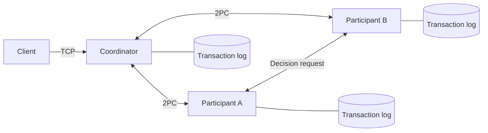

# Distributed Reservation System

A Java 17 reservation system. Servers use Two-Phase Commit (2PC) over TCP
to reserve items in one transaction and recover them after a crash.

Politecnico di Milano · Distributed Systems (090950) · Project 2 · 2026/2027

## Architecture

The client sends a reservation to a coordinator over TCP. Participants vote
and apply the decision. Each server keeps its own transaction log. A server
can act as both coordinator and participant for the same request.



## Project structure

```text
distributed-reservation/
├── .gitignore
├── README.md
├── config/
│   ├── cluster.lan.properties.example
│   ├── cluster.local.properties
│   └── cluster.vm.properties
├── docs/
│   ├── architecture.md
│   ├── deployment.md
│   ├── implementation.md
│   ├── protocol.md
│   ├── recovery.md
│   ├── requirements.md
│   ├── testbed.md
│   └── testing.md
├── infra/
│   ├── cloud-init.yaml
│   ├── collect-logs.sh
│   ├── deploy.sh
│   ├── fault.sh
│   ├── lib.sh
│   ├── network.sh
│   ├── provision.sh
│   ├── reservation@.service
│   └── reset.sh
├── scripts/
│   ├── build.sh
│   ├── local.sh
│   └── test.sh
├── src/
│   └── reservation/
│       ├── Client.java
│       ├── ClusterConfig.java
│       ├── Coordinator.java
│       ├── Endpoint.java
│       ├── Faults.java
│       ├── FrameFields.java
│       ├── Main.java
│       ├── Message.java
│       ├── Participant.java
│       ├── ResourceManager.java
│       ├── Server.java
│       ├── TransactionLog.java
│       ├── Transport.java
│       ├── TxId.java
│       ├── Type.java
│       └── Wire.java
└── tests/
    ├── integration/
    │   └── test_cluster.py
    └── unit/
        └── UnitTests.java
```

## Docs

- [Course requirements](docs/requirements.md)
- [Server roles and resource locks](docs/architecture.md)
- [Messages and 2PC](docs/protocol.md)
- [Logs and restart](docs/recovery.md)
- [Deployment and network settings](docs/deployment.md)
- [Laptop and VM testbed](docs/testbed.md)
- [Implementation plan](docs/implementation.md)
- [Tests and LAN demo](docs/testing.md)

Run `./scripts/test.sh` with a JDK 17 or newer and Python 3. For a live
run, follow the [laptop testbed](docs/testbed.md).
