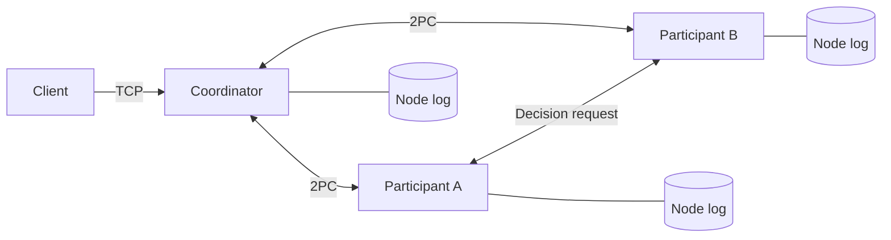

# Architecture

This document describes project design choices. See the
[course requirements](requirements.md) for the assignment.

## Server roles

Each node runs the same Java 17 server and owns a fixed set of resources.
Configuration maps node IDs to TCP addresses and resource IDs to owners. Keep
these mappings and each node's log directory the same across a restart.

The client picks a coordinator for each new transaction and uses that
coordinator for every retry. The owners of the requested resources are the
participants. The coordinator can also be a participant. In that case it runs
the same participant steps locally, counts its own durable vote and ACK, and
keeps coordinator and participant records separate by role in its node log.
There is no coordinator failover within a transaction.

The diagram shows a transaction with a separate coordinator. The
[protocol](protocol.md) also covers a coordinator that owns a requested item.

## Resources and concurrency

A resource is one exclusive item, such as a named piece of equipment. A
reservation names a nonempty set of unique resource IDs. Each item has one
owner and can have at most one committed reservation. Reservations last for
the run, including restarts. The first version has no quantity, time interval,
or cancellation.

A participant checks and tries to acquire all its requested items together
during `PREPARE`. The check and update use a short local critical section with
no network or disk I/O. If any item is committed or held by another transaction,
the participant takes no locks and records a no vote. A reservation lock
belongs to a transaction ID, so another handler can release it and replay
can restore it. Each role serializes state changes for the same transaction.

Participants never wait for a resource lock, so different orders of requests
cannot form a distributed lock wait cycle. Competing requests can both abort.
Repeated collisions can cause livelock or starvation. A client may try again
after a final abort, with a new ID and a short randomized delay. Retries of an
unknown outcome use the original ID. A `READY` participant still waits for a
valid decision and keeps its locks while it waits.

## Planned modules

| File | Role |
| --- | --- |
| `Client.java` | Create transaction IDs, send requests, and show results. |
| `Server.java` | Load settings, accept connections, and dispatch messages. |
| `Transport.java` | Frame and exchange messages over TCP. |
| `Coordinator.java` | Collect votes and ACKs, record decisions, and retry delivery. |
| `Participant.java` | Vote, resolve uncertain transactions, and apply decisions. |
| `ResourceManager.java` | Track local resources, locks, and reservations. |
| `TransactionLog.java` | Append and replay durable records. |
