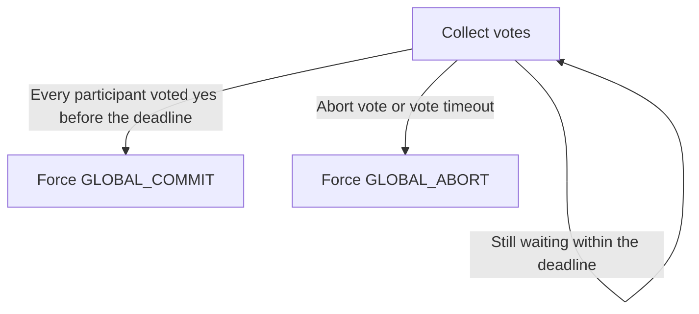

# Messages and Two-Phase Commit

## Transaction key

The client generates a UUID and pairs it with the coordinator's node ID.
After a disconnect or `PENDING` reply, retry at the same coordinator with
the same key and items. The coordinator stores the sorted item IDs. Reusing
the key with different items returns `ID_CONFLICT` after a request is stored.
An [unseen key closed by a decision query](recovery.md#replay) returns `ABORTED`.

## TCP messages

Read and validate a full frame before handling it. A four-byte length covers
the rest of the frame, up to 1 MiB. Next come version byte `1`, the type byte,
the coordinator ID, the UUID, and the sender ID for node messages. Use UTF-8
text with a four-byte byte count and lists with a four-byte item count.
All counts are big-endian. A participant entry is node ID, host, and
four-byte TCP port. Encode the result and decision values below as text.
Check node IDs and addresses against configuration.

| Type | Message | Body |
| --- | --- | --- |
| 1 | `RESERVE` | Item IDs |
| 2 | `RESULT` | `COMMITTED`, `ABORTED`, `PENDING`, `ID_CONFLICT`, or `INVALID_REQUEST` |
| 3 | `PREPARE` | Full participant list, then the receiver's item IDs |
| 4 / 5 | `VOTE_COMMIT` / `VOTE_ABORT` | |
| 6 / 7 | `GLOBAL_COMMIT` / `GLOBAL_ABORT` | |
| 8 | `ACK` | `COMMITTED` or `ABORTED` |
| 9 | `DECISION_REQUEST` | Full participant list from `PREPARE` |
| 10 | `DECISION_REPLY` | `COMMITTED`, `ABORTED`, `VOTE_ABORT`, or `PENDING` |

## Prepare and decide

The [commit flow](../README.md#commit-flow) shows the message order.
**Force** means write the record to stable storage.
The coordinator returns `INVALID_REQUEST` before starting a transaction if
its log record or peer messages exceed the frame limit.

Abort follows the same delivery and ACK steps as commit. The client then
receives `ABORTED` on retry.

- A yes vote puts a participant in `READY` and lets it accept commit. An
  early abort closes the key to late prepares.
- Participants reuse saved votes and ACKs on redelivery. The coordinator
  counts each once per listed participant and retries decision delivery.
  Until `END`, a client retry can return `PENDING`.

## Decision requests

A `READY` participant asks the coordinator or peers from its saved list.
A peer with a saved decision shares it. A peer can also prove abort with a
durable no vote. An `INIT` peer can force that vote before replying and
reject late prepares. Serialize this step with prepare for the same key.

A `READY` peer still waiting for the outcome replies `PENDING`. When all
participants reply `PENDING` and the coordinator is unreachable, they
keep their locks and retry until the coordinator recovers. After learning
the outcome from a peer, a participant still ACKs the coordinator's decision.

See `07-agreement.pdf`, slides 7–11, and the [restart rules](recovery.md).
