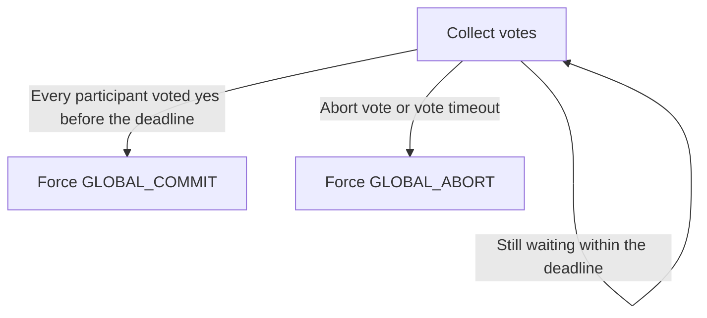
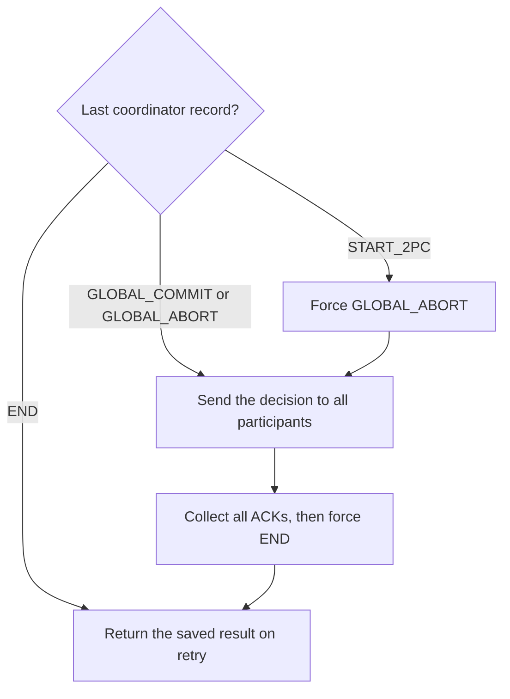

# Protocol and Recovery

## Roles and keys

A transaction has one coordinator and one participant per resource owner.
The coordinator can also vote as a participant. Each item belongs to one
server and can be reserved once. Servers follow the protocol, restart after
crashes, and use stable local storage. Network interruptions eventually heal.

The client uses a UUID and the coordinator ID as the transaction key. A
retry reuses both and the original items. Changing the items for a recorded
request returns `ID_CONFLICT`. See [Wire.java](../src/reservation/Wire.java)
for versioned TCP framing and message fields.

## Prepare and decide

The [commit flow](../README.md#commit-flow) shows the messages and durable
writes. A participant tries to claim all its local items at once during
`PREPARE`. It votes abort if any item is held or reserved. A durable yes
vote moves it to `READY`. It holds its locks until it applies the decision.

Both outcomes use the same delivery and ACK steps. Participants reuse
durable votes and ACKs on redelivery. The coordinator retries missing ACKs
and returns the final result on retry after `END`.

## Decision requests

A `READY` participant can ask the coordinator or a listed peer. A peer can
share its saved decision or prove abort with a durable no vote. A peer that
has yet to vote can record no before replying, which also rejects late
`PREPARE` messages. If every peer is still `READY` and the coordinator is
unreachable, participants keep their locks and retry.

## Replay

Each node [keeps a transaction log](deployment.md#settings). Records carry
the role, transaction key, length, and CRC32. The server forces records before
sending the corresponding messages. Replay truncates an incomplete tail and
stops on checksum errors or inconsistent records.

Participants restore committed items and unresolved `READY` locks, then
resume decision queries. On a valid participant query for an unseen key, the
coordinator records abort and closes that key to a delayed first request.
Completed outcomes stay in the log for retries.

See `07-agreement.pdf`, slides 7–11, for 2PC and blocking.
