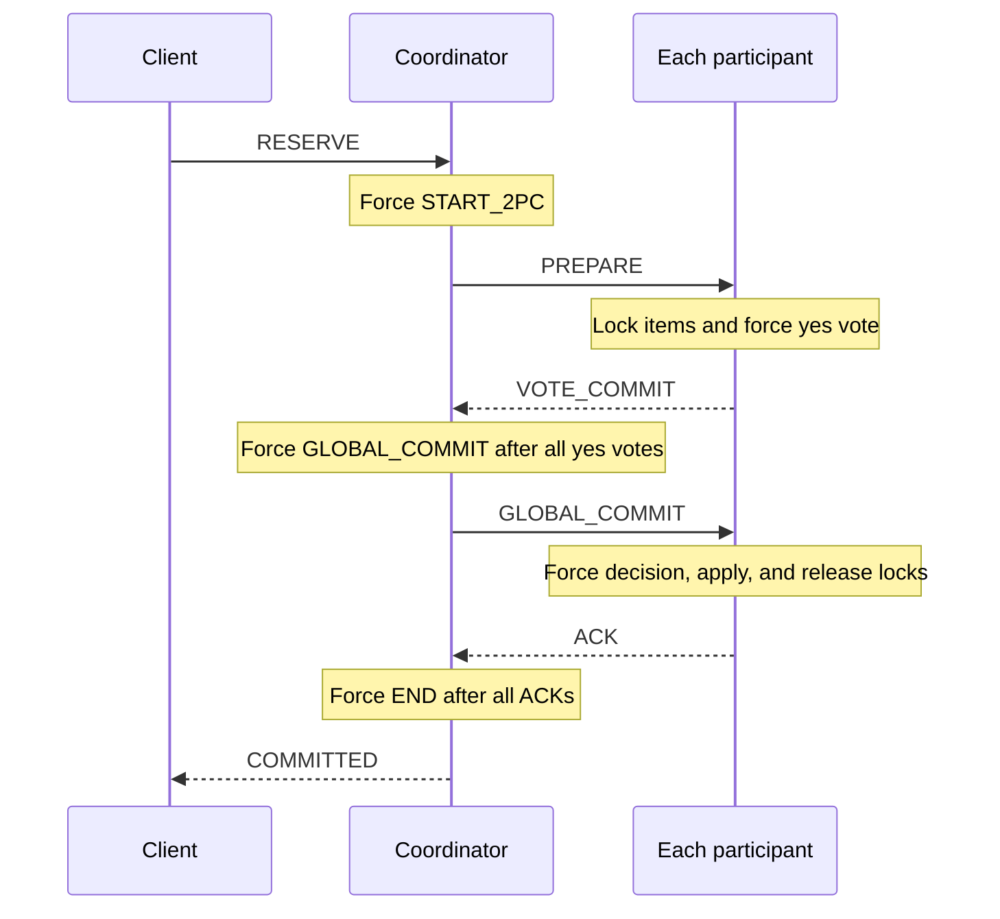

# Messages and Two-Phase Commit

## Messages and transaction IDs

The client generates a UUID before its first send. The transaction key is the
coordinator's node ID and that UUID. The client keeps the key and the original
resource set for retries. The coordinator stores the sorted resource IDs with
the key and rejects reuse with a different set. A request still collecting
votes or waiting for ACKs can return `PENDING`. A timeout or disconnect at the
client leaves the outcome unknown.

TCP messages have a four-byte big-endian length, version byte `1`, and a
one-byte message type followed by the fields below. The length covers all
bytes after the length field and is limited to 1 MiB. Encode text as UTF-8 with
a four-byte byte count and lists with a four-byte item count. Use big-endian
counts throughout. Read and validate a whole frame before handling it. After
a disconnect, reconnect and retry with the same key. Every transaction message
carries the coordinator node ID and UUID in that order. Node messages then
carry the sender's node ID before the fields below.

| Type | Message | Additional fields or purpose |
| --- | --- | --- |
| 1 | `RESERVE` | Resource IDs. |
| 2 | `RESULT` | `COMMITTED`, `ABORTED`, `PENDING`, or `ID_CONFLICT`. |
| 3 | `PREPARE` | Full participant list, then the item IDs assigned to the receiver. |
| 4, 5 | `VOTE_COMMIT`, `VOTE_ABORT` | Vote from a participant. |
| 6, 7 | `GLOBAL_COMMIT`, `GLOBAL_ABORT` | Final decision from the coordinator. |
| 8 | `ACK` | `COMMITTED` or `ABORTED`, matching the decision the participant applied. |
| 9 | `DECISION_REQUEST` | Full participant list from `PREPARE`, so an unprepared member can confirm it is part of the transaction. |
| 10 | `DECISION_REPLY` | `COMMITTED`, `ABORTED`, `VOTE_ABORT`, or `PENDING`. |

A participant entry contains the node ID, host, and four-byte TCP port in
that order. Status values in the table are text. Validate node IDs and
addresses against configuration. Count votes and ACKs only once per expected
participant and accept peer evidence only from the saved participant list.

## Prepare and decide

1. The coordinator saves and forces `START_2PC` with the participant list and
   request. It then sends `PREPARE` to each participant.
2. On its first prepare, a participant logs `INIT` with the participant list
   and local items, then tries to lock its items. It saves its vote before
   sending it. A yes vote leaves it in `READY`. Duplicate prepares do not
   acquire locks again or change the vote.
3. The coordinator commits only after a yes vote from every participant. A no
   vote or a timeout while collecting votes leads to abort. It saves and
   forces the decision before it sends it. Once recorded, the decision is final.
4. Each participant saves and forces the decision before applying it, releasing
   any locks, and sending `ACK`. A repeated decision receives the same ACK
   after the participant has applied it. A participant can accept abort
   before prepare and record it to reject a late prepare. Commit requires a
   saved local yes vote.
5. The coordinator retries delivery until it gets a matching ACK from each
   participant. It then saves `END` and can return the final result to the
   client. A retry before `END` can return `PENDING` and never restarts the vote.

## Decision requests

- A `READY` participant with no outcome asks the coordinator and can ask
  peers from its saved participant list. A peer can share a recorded final
  decision. A durable no vote also proves that the coordinator cannot commit.
- A listed peer that has yet to vote can serialize the decision request with
  any incoming `PREPARE`. If still unprepared, it may first save and force a
  no vote for that key, then return it. A later `PREPARE` must receive no.
  This is the `INIT` case in the lecture. An empty log lookup, a timeout, or
  an unreachable peer alone gives no decision.
- A `READY` peer without a decision returns `PENDING`. If every participant
  is in this state and the coordinator is unreachable, all remain blocked.
  They keep their locks and retry the query until there is valid evidence or
  the coordinator recovers. A participant that learns a decision from a peer
  still acknowledges the coordinator when it receives the matching decision.

See slides 7–11 of `07-agreement.pdf` for the course protocol and its blocking
case. See [log and recovery](recovery.md) for the restart rules.
