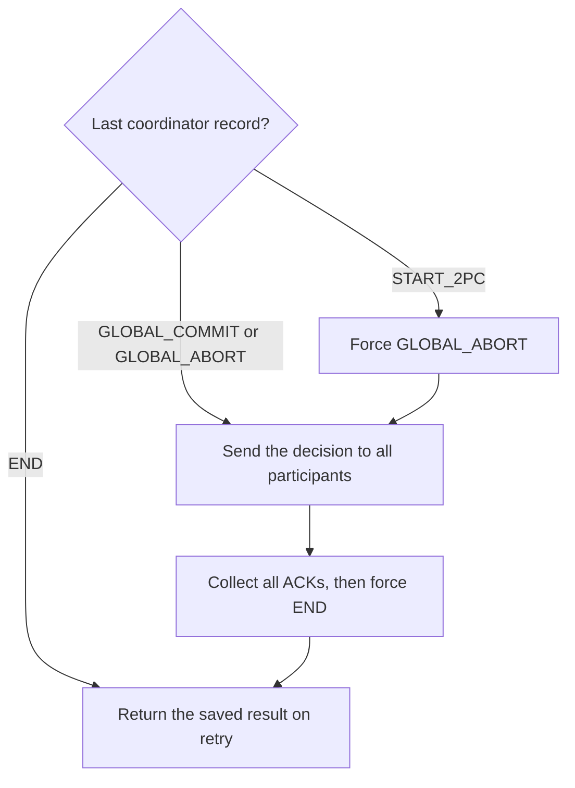

# Logs and Restart

## Log format

Each node appends to its own log under `run/`. Serialize appends and tag
records by role. A frame is a four-byte big-endian payload length, up to
1 MiB, then the payload and a four-byte CRC32 over the length and payload.
The payload starts with version `1`, role, record type, and transaction key.
Use the [TCP field encoding](protocol.md#tcp-messages) for the record data.

| Role | Record | Data |
| --- | --- | --- |
| Coordinator | `START_2PC` | Sorted item IDs and full participant list |
| Coordinator | `GLOBAL_COMMIT` / `GLOBAL_ABORT` | Final decision |
| Coordinator | `END` | Completion after all ACKs |
| Participant | `INIT` | Participant list and local item IDs |
| Participant | `VOTE_COMMIT` / `VOTE_ABORT` | Vote, participant list, and local items when known |
| Participant | `GLOBAL_COMMIT` / `GLOBAL_ABORT` | Decision and local items for replay |

Write the full frame with `FileChannel`, then call `force(true)`. Stop
serving on a write or force error. Replay discards an incomplete final frame
and forces the truncation. An invalid length, bad checksum on a complete
frame, or inconsistent record stops recovery. The failure model assumes the
disk and forced records survive a restart. See
[Java 17 FileChannel.force](https://docs.oracle.com/en/java/javase/17/docs/api/java.base/java/nio/channels/FileChannel.html#force(boolean)).

## Replay

Replay before serving requests. For each transaction the coordinator started,
its last record tells it what to do.

Decision delivery includes the local participant when the coordinator has
both roles.

- **Participant.** Rebuild committed items and locks for unresolved yes
  votes. `INIT` alone restores the request state. Ask for decisions on
  transactions still in `READY` and ACK repeated decisions after replay.
- **Unseen key.** On a valid participant query, the named coordinator first
  forces abort under the same per-key guard used for `START_2PC`. That
  closes the key to a delayed request. A query during voting gets `PENDING`.
  A first `RESERVE` for a fresh key starts the transaction.

## Keeping results

At `END`, drop timers and delivery state. Keep the durable request,
decision, completion marker, and participant records for the whole run.
They let retries and peer queries get the same answer. For a fresh demo,
stop all nodes and reset their run directories together.
